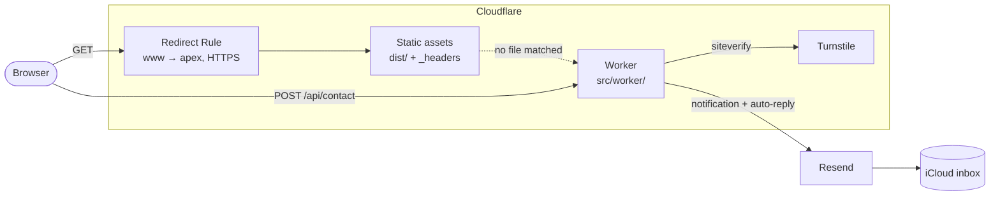

# Architecture

A static site plus one small Worker.

- **Astro** renders every page to HTML at build time (`dist/`). No server rendering.
- **Cloudflare** serves `dist/` from its edge through the Worker `minimalist-website`.
- The same **Worker** handles the only dynamic request, `POST /api/contact`: Turnstile,
  validation, email through **Resend**.
- **GitHub Actions** checks, builds and deploys. Nothing is stored: no database, sessions or cookies.



## A request

1. **Edge rules:** `www` → apex (301) and HTTP → HTTPS, before anything else.
2. **Static file?** Served directly with the headers from `public/_headers`; the Worker doesn't
   run. `force-trailing-slash` redirects `/work` to `/work/`.
3. **No file:** the Worker runs. `/api/contact` goes to the form handler; everything else back
   to `env.ASSETS`, which serves the nearest `404.html` (`/hr/…` gets the Croatian one).
4. **In the browser:** the page carries its CSP `<meta>`; two inline scripts run before paint
   (JS flag, theme), then the bundled scripts. Cloudflare injects the analytics beacon.

## Environments

| Environment     | URL                                                             | Runs                                       | Form                                 |
| :-------------- | :-------------------------------------------------------------- | :----------------------------------------- | :----------------------------------- |
| Dev server      | `http://localhost:4321`                                         | `pnpm dev`                                 | No Worker, no `/api/contact`         |
| Local Worker    | `http://localhost:8787`                                         | `pnpm run build && pnpm exec wrangler dev` | Works with `.dev.vars` (test keys)   |
| Staging preview | `https://staging-minimalist-website.minimalist-1a8.workers.dev` | Version under alias `staging`, `noindex`   | Renders, can't send (Turnstile host) |
| Production      | `https://minimalist.hr`                                         | `wrangler deploy` from `main`              | Sends                                |

`wrangler dev` behaves like production (headers, 404s, Worker); `pnpm dev` doesn't.

## Code map

```text
src/
├─ pages/          route files; hr/ mirrors with translated folder names
├─ views/          one view per page: its copy, its queries
├─ layouts/        BaseLayout: head, skip link, header, main, footer
├─ components/     UI pieces; take data and locale as props
├─ content/        work/ and insights/, one Markdown file per language
├─ data/           services, steps, skills, stats, faq, about
├─ i18n/           locales, route map, UI strings, helpers
├─ lib/            content queries, navigation, images, sitemap, JSON-LD, theme, inline scripts,
│                  inquiry (shared with the Worker)
├─ integrations/   localized-404 (moves hr/404/index.html to hr/404.html)
├─ scripts/        browser modules: reveal, background-field, contact-form
├─ styles/         tokens, fonts, base, utilities, motion
├─ assets/images/  photographs and screenshots
├─ site.config.ts  site facts and flags
└─ worker/         the Cloudflare Worker
```

Styles: `global.css` declares `@layer reset, base, utilities`. Component styles and `motion.css`
are unlayered, so they win; `motion.css` prefixes `:root` so reveal states beat a component's
own rules.

## Stack

Node 24, pnpm (pinned), Astro 7, TypeScript strict, `sharp`. Two runtime dependencies. Quality:
ESLint, Prettier, `astro check`, Playwright with axe, Lighthouse CI. Services: Cloudflare
(Workers, DNS, Turnstile, Web Analytics), Resend, iCloud+, GitHub, SonarQube Cloud. Versions are in
`package.json`.

Deliberately not used: UI frameworks, Tailwind or UI kits, MDX, a CMS, `@astrojs/sitemap`,
Google Fonts, Cloudflare Pages or Git integration, unit test frameworks.

## Principles

- **Static first.** The Worker exists only because the form needs a secret.
- **Progressive enhancement.** Without JavaScript every page reads, navigates and switches
  language.
- **One source per fact.** Routes in `routes.ts`, form rules in `inquiry.ts`, company facts in
  `site.config.ts`, brand values in `tokens.css`, inline script bodies in `inline-scripts.ts`.
- **Mistakes fail the build.** Collection schemas, typed UI strings per language, image keys
  that must have files.
- **Store nothing.** The form emails and forgets; logs never hold content.
