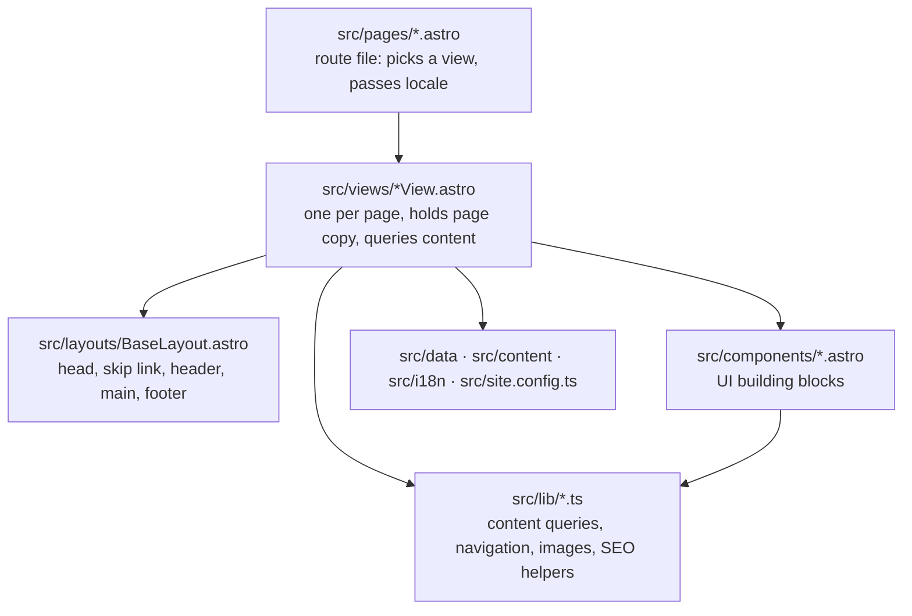

# Frontend architecture

## Layers



- **Route files** are a few lines. `src/pages/services.astro` and
  `src/pages/hr/usluge/index.astro` both render `<ServicesView locale="…" />`. Detail pages
  (`work/[slug].astro`, `hr/radovi/[slug].astro`, and the insights equivalents) also define
  `getStaticPaths` from the collection.
- **Views** own a page. They hold that page's copy in a typed `copy` object (`en` and `hr`),
  read collections and data modules, and pass everything down as props.
- **BaseLayout** is the only layout. Props: `title`, `description`, `alternates` (omit for
  non-indexable pages), `noindex`, `structuredData`.
- **Components** receive data and a `locale`; they don't query collections themselves.

## Directory map

```text
src/
├─ pages/            route files; hr/ mirrors with translated folder names
├─ views/            one view per page type (12)
├─ layouts/          BaseLayout.astro
├─ components/       ~45 components (chrome, cards, form controls, SEO head)
├─ content/          work/{en,hr}/*.md, insights/{en,hr}/*.md
├─ content.config.ts collection schemas
├─ data/             services, steps, skills, stats, faq, about (Localized copy)
├─ i18n/             config, routes, ui strings, helpers
├─ lib/              content, navigation, images, format, sitemap, structured-data,
│                    theme, inline-scripts, inquiry (shared with the Worker)
├─ integrations/     localized-404.ts (build hook)
├─ scripts/          browser modules: reveal, background-field, contact-form
├─ styles/           global.css → tokens, fonts, base, utilities, motion
├─ assets/images/    photographs and screenshots (processed by astro:assets)
├─ site.config.ts    site facts and feature flags
└─ worker/           Cloudflare Worker (see Backend architecture)
```

## Styles

`src/styles/global.css` is imported once by `BaseLayout` and declares cascade layers:

```css
@layer reset, base, utilities;
```

| File            | Layer                    | Contents                                                                               |
| :-------------- | :----------------------- | :------------------------------------------------------------------------------------- |
| `tokens.css`    | none (custom properties) | Colours per theme, type scale, tracking, leading, layout, motion, z-index              |
| `fonts.css`     | none                     | Two `@font-face` rules (latin, latin-ext)                                              |
| `base.css`      | `reset`, `base`          | Reset, element defaults, focus style, `scroll-padding-top`, reduced-motion kill switch |
| `utilities.css` | `utilities`              | `.container`, `.rule-top` / `.rule-bottom`, `.link-line`, `.label`, `.visually-hidden` |
| `motion.css`    | unlayered                | Reveal states (`data-reveal`, `data-rule`, `data-draw`), view transitions              |

Component `<style>` blocks are scoped by Astro and unlayered, so they win over every layer.
`motion.css` is unlayered too, and prefixes its selectors with `:root` so the reveal states beat
a component's own single-class rules.

**Scoped CSS doesn't reach a child component's root element.** A class passed from the parent
to a child component is silently dropped. Give the child a prop, wrap it in an element the
parent owns, or (rarely, and with a comment) use `:global()`.

## Browser JavaScript

No framework runtime. Each script is a few lines to a few hundred, bundled and hashed by Astro.

| Script           | Where                                                         | Runs on                          | Does                                                           |
| :--------------- | :------------------------------------------------------------ | :------------------------------- | :------------------------------------------------------------- |
| JS flag (inline) | `src/lib/inline-scripts.ts`                                   | Every page, blocking in `<head>` | Sets `<html data-js>` so JS-only controls never flash          |
| Theme (inline)   | `src/lib/inline-scripts.ts`                                   | Every page, blocking in `<head>` | Applies the saved theme and `theme-color` before first paint   |
| Theme toggle     | `ThemeToggle.astro`                                           | Every page                       | Toggles, saves, keeps all toggles in sync                      |
| Mobile menu      | `MobileMenu.astro`                                            | Every page                       | Opens and closes the dropdown; Esc, focus-out, resize handling |
| Header focus fix | `Header.astro`                                                | Every page                       | Scrolls focused elements clear of the sticky header (WebKit)   |
| Scroll reveal    | `src/scripts/reveal.ts` via `BaseLayout`                      | Every page                       | Enter and Reveal motion for content below the fold             |
| Background field | `src/scripts/background-field.ts` via `BackgroundField.astro` | Every page                       | The decorative canvas                                          |
| Headline blur    | `Hero.astro`                                                  | Home                             | Fits the headline's blurred patch to its widest phrase         |
| Contact form     | `src/scripts/contact-form.ts` via `ContactForm.astro`         | Contact pages                    | Validation, Turnstile, fetch submit, messages                  |

Copy never lives in a script. Components pass strings through `data-*` attributes (the form's
`data-messages`, the menu button's `data-label-open/close`).

**Inline scripts and the CSP.** The two blocking scripts must run before first paint, so they
can't be bundled modules. Their exact text is exported from `src/lib/inline-scripts.ts`,
rendered with `set:html`, and hashed for the CSP in `astro.config.mjs` from the same strings.
Never write an `is:inline` script directly. See [Security](/Architecture/Security).

## Progressive enhancement

- `<html data-js>` is the switch. CSS hides JS-only controls (theme toggle, menu button)
  under `:root:not([data-js])`, and shows the menu panel as a plain list instead.
- The reveal script only holds back elements that start **below** the fold, and only after it
  has run. Without JavaScript or with reduced motion nothing is ever hidden.
- The form posts to `/api/contact` as a normal form; the script takes over with `fetch` when
  it loads. Turnstile needs JavaScript, so a `<noscript>` note offers the email address.

## Images

`ImageFrame` takes an image key, looks it up in `src/lib/images.ts`, and renders Astro's
`<Image>` cropped to the slot's ratio at widths 480, 800, 1200 and 1600, with `sizes` from the
caller. Images below the fold load lazily; one image per page can pass `priority`. Without a key,
or with a key that doesn't exist, it renders the striped placeholder. Both reserve the same
aspect ratio, so there is no layout shift. See [Add or replace an image](/Guides/Add-or-Replace-an-Image).

An image with a light-theme version (`<key>-light.png`) renders both versions and CSS shows the
one matching `data-theme`; the light one is always lazy ([Theme](/How-It-Works/Theme#images)).
`AnnotatedImage` wraps `ImageFrame` for the case study hero and gallery and adds the image's
notes from the registry ([Design system](/Product/Design-System#images)).

## Build-time helpers

| Module                          | Purpose                                                                                                        |
| :------------------------------ | :------------------------------------------------------------------------------------------------------------- |
| `lib/content.ts`                | `getWork`, `getFeaturedWork`, `getPublishedWork`, `getInsights`, `getEntryAlternates`, `slugOf`, path builders |
| `lib/navigation.ts`             | `primaryNav`, `footerNav`, `buildNav` (current state, hidden sections), `nextSection` (CTA chain)              |
| `lib/images.ts`                 | Image registry: key → file + bilingual alt text; fails the build on a missing file                             |
| `lib/format.ts`                 | Insight dates (`2026 / 08`, `2026. / 08`), reading time (200 words a minute)                                   |
| `lib/sitemap.ts`                | Builds `/sitemap.xml` from the route map and translation keys                                                  |
| `lib/structured-data.ts`        | Organization, Article, BreadcrumbList JSON-LD                                                                  |
| `lib/theme.ts`                  | Default theme, storage key, theme colours                                                                      |
| `integrations/localized-404.ts` | After the build, moves `hr/404/index.html` to `hr/404.html`                                                    |

## Astro configuration

`astro.config.mjs` sets: `site` (from `siteConfig.url`), `trailingSlash: 'always'`, i18n with
`prefixDefaultLocale: false`, the localised-404 integration, the CSP, and the typed
`PUBLIC_TURNSTILE_SITE_KEY` env field. See [Configuration](/Technical-Specification/Configuration).
