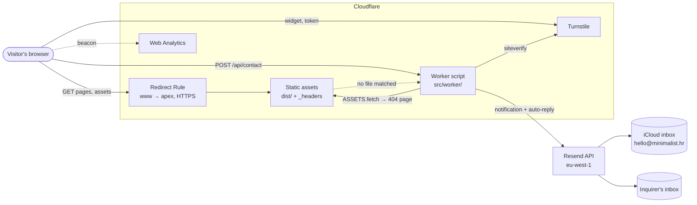
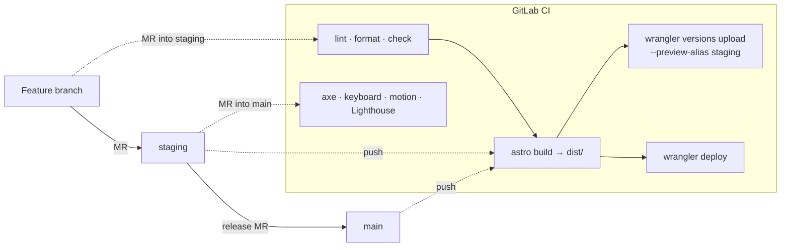

# System architecture

## Summary

A static site plus one small serverless function.

- **Astro** renders every page to HTML at build time (`dist/`). There is no server rendering.
- **Cloudflare** serves `dist/` as static assets from its edge, through a Worker named
  `minimalist-website`.
- The same **Worker script** handles the only dynamic request, `POST /api/contact`: it checks
  the Turnstile token, validates the inquiry and emails it through **Resend**.
- **GitLab CI** builds and deploys. Nothing is stored anywhere: no database, no sessions, no cookies.

## Context diagram

## Build and deploy

Details: [Infrastructure](/Architecture/Infrastructure) and [Workflow](/Development/Workflow).

## Building blocks

| Block           | Where                                                  | Responsibility                                                                             |
| :-------------- | :----------------------------------------------------- | :----------------------------------------------------------------------------------------- |
| Pages and views | `src/pages/`, `src/views/`                             | Map URLs to pages; render each page for either language                                    |
| Components      | `src/components/`                                      | Reusable UI, each with scoped styles and, where needed, a small script                     |
| Content         | `src/content/`, `src/data/`, `src/i18n/ui.ts`          | Case studies and insights (Markdown), structured copy, UI strings                          |
| Styles          | `src/styles/`                                          | Tokens, fonts, reset and base, utilities, motion states                                    |
| Browser scripts | `src/scripts/`, `<script>` in components               | Theme, menu, scroll reveal, background field, contact form                                 |
| Build helpers   | `src/lib/`, `src/integrations/`                        | Content queries, navigation, sitemap, JSON-LD, image registry, CSP strings, localised 404s |
| Worker          | `src/worker/`                                          | `POST /api/contact`; everything else back to the assets                                    |
| Shared contract | `src/lib/inquiry.ts`                                   | Form fields, limits, allowed values, response type; imported by the form and the Worker    |
| Static files    | `public/`                                              | Fonts, icons, share image, manifest, `_headers`                                            |
| Audits          | `tests/`, `scripts/lighthouse.mjs`, `lighthouserc.cjs` | Accessibility, keyboard, motion, Lighthouse                                                |

## Environments

| Environment           | URL                                                             | How it runs                                         | Form                                                             |
| :-------------------- | :-------------------------------------------------------------- | :-------------------------------------------------- | :--------------------------------------------------------------- |
| Dev server            | `http://localhost:4321`                                         | `pnpm dev` (Astro, hot reload)                      | No Worker, so `/api/contact` is missing                          |
| Local Workers runtime | `http://localhost:8787`                                         | `pnpm run build`, then `pnpm exec wrangler dev`     | Works with `.dev.vars` (test Turnstile secret, `console` mailer) |
| Staging preview       | `https://staging-minimalist-website.minimalist-1a8.workers.dev` | Worker version under the `staging` alias; `noindex` | Renders, but cannot send (Turnstile hostname)                    |
| Production            | `https://minimalist.hr`                                         | `wrangler deploy` from `main`                       | Sends through Resend                                             |

## Design principles

- **Static first.** Everything that can be decided at build time is. The Worker exists only
  because the form needs a secret.
- **Progressive enhancement.** HTML and CSS carry the content; scripts add behaviour. With
  JavaScript off, every page reads, navigates and switches language.
- **One source per fact.** Routes in the route map, form rules in `inquiry.ts`, company facts
  in `site.config.ts`, brand values in `tokens.css`, CSP script bodies in `inline-scripts.ts`.
- **Type-checked content.** Collections have schemas, UI strings are typed per language, image
  keys must have files. A mistake fails the build rather than shipping.
- **Store nothing.** The form emails and forgets. Logs never contain message content.
- **Swappable edges.** The email provider sits behind a `Mailer` interface; changing provider
  means one new file.
