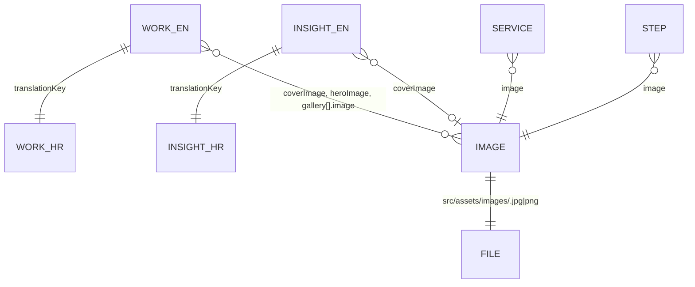

# Data model

The site has no database. All data is in the repository and is read at build time, except the
contact form submission, which passes through the Worker and is emailed.

## Sources

| Source                | File(s)                                    | Shape                                    | Read by                                     |
| :-------------------- | :----------------------------------------- | :--------------------------------------- | :------------------------------------------ |
| Case studies          | `src/content/work/{en,hr}/*.md`            | Content collection `work`                | Home, Work list, case study pages, sitemap  |
| Insights              | `src/content/insights/{en,hr}/*.md`        | Content collection `insights`            | Home, Insights list, article pages, sitemap |
| Services              | `src/data/services.ts`                     | `Service[]`                              | Home, Services                              |
| Steps                 | `src/data/steps.ts`                        | `Step[]`                                 | Home, Approach                              |
| Skills                | `src/data/skills.ts`                       | `SkillGroup[]`                           | Home, Skills                                |
| Studio figures        | `src/data/stats.ts`                        | `Stat[]`                                 | Home, About                                 |
| FAQ                   | `src/data/faq.ts`                          | `FaqItem[]`                              | Services                                    |
| Manifesto, principles | `src/data/about.ts`                        | `Localized<string>[]`                    | About                                       |
| Image registry        | `src/lib/images.ts` + `src/assets/images/` | key → file + alt                         | `ImageFrame` everywhere                     |
| UI strings            | `src/i18n/ui.ts`                           | `Record<Locale, Record<UiKey, string>>`  | Components, Worker auto-reply               |
| Route map             | `src/i18n/routes.ts`                       | `Record<RouteKey, Record<Locale, path>>` | Navigation, language switch, sitemap        |
| Site facts and flags  | `src/site.config.ts`                       | `siteConfig`                             | Footer, Legal, Contact, JSON-LD, emails     |
| Inquiry contract      | `src/lib/inquiry.ts`                       | Constants and types                      | Contact form, Worker                        |

## Relationships



## Content collections

Defined in `src/content.config.ts` with Zod schemas; a file that doesn't match fails the build.

**File layout.** One file per language. The **file name is the URL slug** in that language;
the folder is the locale.

```text
src/content/work/en/lift-mucnjak-website.md     → /work/lift-mucnjak-website/
src/content/work/hr/lift-mucnjak-web-stranica.md → /hr/radovi/lift-mucnjak-web-stranica/
```

The two files share a `translationKey`. `locale` in the frontmatter must match the folder.
If one language is missing, the language switch on the other falls back to the list page.

### `work`

| Field            | Type                                         | Req. | Purpose                                                                                                              |
| :--------------- | :------------------------------------------- | :--: | :------------------------------------------------------------------------------------------------------------------- |
| `title`          | string                                       |  ✓   | Page title and card heading                                                                                          |
| `locale`         | `en` \| `hr`                                 |  ✓   | Must match the folder                                                                                                |
| `translationKey` | string                                       |  ✓   | Pairs the two languages                                                                                              |
| `sector`         | string                                       |  ✓   | Metadata row, card                                                                                                   |
| `year`           | integer                                      |  ✓   | Card; engagement fallback                                                                                            |
| `client`         | string                                       |      | Shown only with the client's written permission                                                                      |
| `engagement`     | string                                       |      | e.g. "14 weeks, 2026"; falls back to `year`                                                                          |
| `scope`          | string                                       |      | e.g. "Rebuild"                                                                                                       |
| `website`        | URL                                          |      | Live project, linked from the header (new tab)                                                                       |
| `summary`        | string                                       |  ✓   | Work list line, meta description; home card line when there's no `cardMetric`                                        |
| `cardMetric`     | string                                       |      | Result line on the home card                                                                                         |
| `status`         | `published` \| `in-progress`                 |  ✓   | In-progress: card only, no page, not in the sitemap                                                                  |
| `featured`       | boolean                                      |      | Default `false`. Shows in "Selected work" on the home page                                                           |
| `order`          | integer                                      |  ✓   | Sort order, lowest first                                                                                             |
| `coverImage`     | image key                                    |      | Home card and Work list image                                                                                        |
| `coverCaption`   | string                                       |  ✓   | Placeholder caption when there's no `coverImage`                                                                     |
| `heroImage`      | image key                                    |      | 16:9 image on the case study page                                                                                    |
| `heroCaption`    | string                                       |      | Placeholder caption for the hero                                                                                     |
| `sections`       | `{ label, paragraphs: { text, lead? }[] }[]` |      | Body blocks in order (Context / The problem / What we removed / What we built). `lead: true` sets a paragraph in ink |
| `stack`          | `{ text?, tools: string[] }`                 |      | "Tech stack": a note and tool tags (not translated)                                                                  |
| `gallery`        | `{ caption, image? }[]`                      |      | Images below the sections                                                                                            |
| `results`        | `{ value, label }[]`                         |      | Measured figures                                                                                                     |
| `quote`          | `{ text, name, role }`                       |      | Client-approved quote; the quotation marks are part of `text`                                                        |
| `ctaTitle`       | string                                       |      | Closing question on the page                                                                                         |

The case study body comes from frontmatter (`sections`), not the Markdown body.

### `insights`

| Field            | Type         | Req. | Purpose                                                                      |
| :--------------- | :----------- | :--: | :--------------------------------------------------------------------------- |
| `title`          | string       |  ✓   | Heading, `<title>`, JSON-LD headline                                         |
| `locale`         | `en` \| `hr` |  ✓   | Must match the folder                                                        |
| `translationKey` | string       |  ✓   | Pairs the two languages                                                      |
| `date`           | date         |  ✓   | Shown as `2026 / 09` (EN) or `2026. / 09` (HR); sorts the list, newest first |
| `category`       | string       |  ✓   | e.g. "Practice"                                                              |
| `excerpt`        | string       |  ✓   | List row, home card, meta description, JSON-LD description                   |
| `coverImage`     | image key    |      | Cover image                                                                  |
| `coverCaption`   | string       |  ✓   | Placeholder caption                                                          |
| `draft`          | boolean      |      | Default `false`. Drafts are left out of the build                            |
| `author`         | string       |      | Defaults to `siteConfig.author`                                              |
| `ctaTitle`       | string       |      | Closing question; falls back to the Insights default                         |

The article body is the Markdown body. Reading time is computed from it at 200 words a minute.

## Data modules

Every text field is a `Localized<string>` (`{ en: string; hr: string }`), so a missing
translation is a type error.

| Module        | Interface    | Fields                                                                                                              |
| :------------ | :----------- | :------------------------------------------------------------------------------------------------------------------ |
| `services.ts` | `Service`    | `number`, `title`, `description` (home), `detail` (Services), `solves`, `receives`, `image` (`ImageKey`), `caption` |
| `steps.ts`    | `Step`       | `number`, `title`, `description` (home), `detail` (Approach), `image`, `caption`                                    |
| `skills.ts`   | `SkillGroup` | `label`, `description` (home), `detail` (Skills), `summary`, `tools: string[]`                                      |
| `stats.ts`    | `Stat`       | `value` (e.g. `5+`), `label`                                                                                        |
| `faq.ts`      | `FaqItem`    | `question`, `answer`                                                                                                |
| `about.ts`    | —            | `principles`, `manifesto`                                                                                           |

Data modules use `ImageKey` (a typed union of registry keys), so a wrong key is a type error.
Content collections use plain strings; an unknown key there falls back to the placeholder.

## Image registry

`src/lib/images.ts` maps each key to a file and its alt text in both languages:

```ts
'step-build': { en: 'Source code on a screen.', hr: 'Izvorni kod na ekranu.' },
```

- The file is `src/assets/images/<key>.jpg` (photographs) or `.png` (screenshots).
- A key without a file fails the build.
- `studioImage(key)` returns `undefined` for a missing or unknown key, so the slot shows the
  placeholder instead.

## Site configuration

`src/site.config.ts`:

| Field                  | Use                                                                                               |
| :--------------------- | :------------------------------------------------------------------------------------------------ |
| `name`, `url`, `email` | Site name, canonical origin (also `site` in Astro), contact address                               |
| `author`               | Default insight byline                                                                            |
| `showInsights`         | Feature flag for the whole Insights section                                                       |
| `company.*`            | Legal name, owner, address, OIB, registration number, bank, IBAN (footer, Legal, JSON-LD, emails) |

## Inquiry contract

`src/lib/inquiry.ts` is imported by both the form and the Worker, so they can't disagree.

| Export            | Content                                                                                                                          |
| :---------------- | :------------------------------------------------------------------------------------------------------------------------------- |
| `timelineValues`  | `asap`, `1-3m`, `3-6m`, `exploring`                                                                                              |
| `budgetValues`    | `lt500`, `500-2k`, `2k-5k`, `5k-15k`, `gt15k`, `unsure`                                                                          |
| `budgetAmounts`   | Display labels (`< €500` … `€15,000 +`), same in both languages                                                                  |
| `fieldLimits`     | name 120, email 200, company 120, role 120, brief 5000                                                                           |
| `emailPattern`    | `/^[^\s@]+@[^\s@]+\.[^\s@]+$/`                                                                                                   |
| `honeypotField`   | `website`                                                                                                                        |
| `contactEndpoint` | `/api/contact`                                                                                                                   |
| `InquiryResponse` | `{ ok: true }` \| `{ ok: false, error: 'invalid', fields }` \| `{ ok: false, error: 'verification' \| 'send' \| 'unavailable' }` |

The submission itself is described in [Contact form](/How-It-Works/Contact-Form) and
[Privacy and data handling](/Data/Privacy-and-Data-Handling).

## Browser storage

One key: `localStorage['mn-theme']` = `light` or `dark`. Nothing else is stored in the browser.
