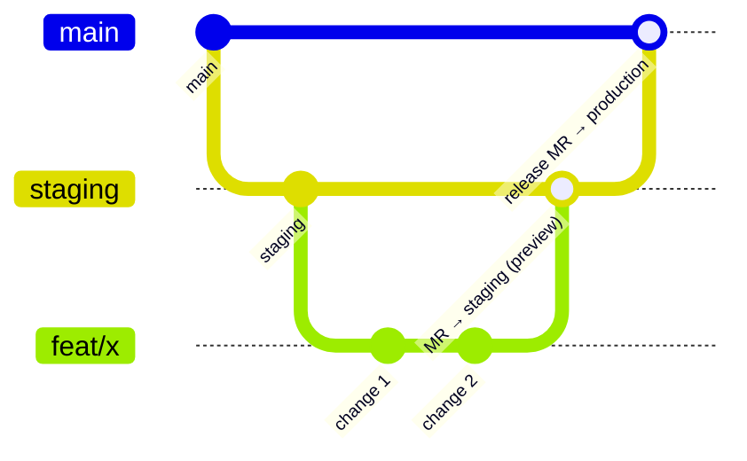

# Workflow

## Branches



| Branch                      | Purpose                                                                                      | Who writes to it                       |
| :-------------------------- | :------------------------------------------------------------------------------------------- | :------------------------------------- |
| `main`                      | Production. Every merge deploys minimalist.hr                                                | Release and hotfix merge requests only |
| `staging`                   | Finished work waiting for release. Every merge refreshes the staging preview. Default branch | Merge requests only                    |
| `feat/…`, `fix/…`, `docs/…` | One piece of work                                                                            | You                                    |

Both `main` and `staging` are protected: no direct pushes, merges need a passing pipeline.

## Making a change

1. **Branch off `staging`:** `git switch staging && git pull && git switch -c feat/short-name`.
2. **Read first.** Check the relevant part of this wiki and the design. If the change touches
   brand, layout or copy, the design is the spec.
3. **Small steps.** After each step:

   ```bash
   pnpm run lint && pnpm run format:check && pnpm run check && pnpm run build
   ```

   Then commit. One logical change per commit.

4. **Test what you changed.** Run the relevant tests rather than everything, for example
   `pnpm exec playwright test -g "contact form" --project=mobile --project=desktop`.
   Larger UI changes: also `pnpm run test:a11y:browsers` locally.
5. **Update the wiki** in the same branch if behaviour, configuration or structure changed.
6. **Push and open a merge request into `staging`.** The pipeline runs lint, format check, type
   checks and the build.
7. **Merge.** The pipeline builds and uploads the staging preview. Check it (GitLab → Operate →
   Environments → `staging`, or https://staging-minimalist-website.minimalist-1a8.workers.dev/).
   The form renders there but can't send.

## Releasing

1. Open a merge request **`staging` → `main`**. It runs the checks, the build and the `audit`
   job (axe, keyboard, motion, Lighthouse). While it's open, every merge into `staging` reruns it.
2. When it's green and the preview looks right, merge it. **Don't squash**, or the branches drift
   apart.
3. The `main` pipeline builds, runs `wrangler deploy`, then publishes `docs/wiki/` to the GitLab
   wiki. Check https://minimalist.hr.

Details and rollback: [Release and roll back](/Guides/Release-and-Roll-Back).

## Hotfixes

1. Branch off `main`, fix, open a merge request into `main`.
2. After it deploys, merge `main` back into `staging`.

## What runs where

| Event                    | Lint, format, types | Build | Audit | Deploy          |
| :----------------------- | :-----------------: | :---: | :---: | :-------------- |
| Push to a feature branch |          —          |   —   |   —   | —               |
| MR into `staging`        |          ✓          |   ✓   |   —   | —               |
| Merge into `staging`     |          —          |   ✓   |   —   | Staging preview |
| MR `staging` → `main`    |          ✓          |   ✓   |   ✓   | —               |
| Merge into `main`        |          —          |   ✓   |   —   | Production      |

## Commit messages

Short, imperative, sentence case, no trailing period. Say what changes for the site, not which
file you touched. An optional area prefix is fine.

```text
Keep the background field out of the contact form's text fields
Require consent to the privacy policy on the contact form
Contact form: auto-reply to the sender, in their language
```

## Merge requests

- Title like a commit message; description says what and why, and how you checked it.
- Screenshots for visual changes (mobile and desktop, both themes if colours are involved).
- Note anything that needs a dashboard change (Cloudflare, GitLab variables, Resend).

## Changes that need a word first

- `.gitlab-ci.yml`, `wrangler.jsonc`, `.gitignore`, `.nvmrc`: explain the problem before changing.
- New dependencies: state what and why; get approval.
- New sections, components or visual styles not in the design: ask the owner.
- Brand rules: not changed without an approved deviation in the [Decision log](/Overview/Decision-Log).
