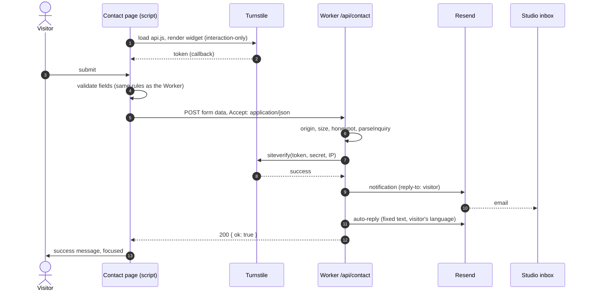

# Contact form

The one interactive feature with a server side. Files:

| Part              | File                                                                                  |
| :---------------- | :------------------------------------------------------------------------------------ |
| Markup and copy   | `src/components/ContactForm.astro` (+ `TextField`, `ChipGroup`, `Checkbox`, `Button`) |
| Browser behaviour | `src/scripts/contact-form.ts`                                                         |
| Shared contract   | `src/lib/inquiry.ts`                                                                  |
| Server            | `src/worker/contact.ts`, `validation.ts`, `turnstile.ts`                              |
| Emails            | `src/worker/compose.ts`, `autoreply.ts`, `mail/`                                      |
| Strings           | `form.*` and `email.*` in `src/i18n/ui.ts`                                            |

## Round trip

## Fields

| Field        | Name                    | Control                                   | Required      |
| :----------- | :---------------------- | :---------------------------------------- | :------------ |
| Name         | `name`                  | text, `autocomplete="name"`               | yes           |
| Email        | `email`                 | email, `autocomplete="email"`             | yes           |
| Company      | `company`               | text, `autocomplete="organization"`       | no            |
| Role         | `role`                  | text, `autocomplete="organization-title"` | no            |
| Timeline     | `timeline`              | radio chips                               | no            |
| Budget (EUR) | `budget`                | radio chips                               | no            |
| Brief        | `brief`                 | textarea, with a hint                     | yes           |
| Consent      | `consent`               | checkbox, value `yes`, links to Legal     | yes           |
| Language     | `locale`                | hidden                                    | —             |
| Honeypot     | `website`               | hidden text, `tabindex="-1"`, off screen  | must be empty |
| Turnstile    | `cf-turnstile-response` | added by the widget                       | yes           |

Field limits and allowed values: [Data model → Inquiry contract](/Data/Data-Model#inquiry-contract).

## In the browser

`enhanceContactForm` runs on every `[data-contact-form]`:

1. **Turnstile** loads once, only on this page, with `render=explicit`. The widget uses the
   site key from the build (`PUBLIC_TURNSTILE_SITE_KEY`), the page language and the current
   theme, and `appearance: 'interaction-only'`, so most visitors never see it.
2. **Validation.** The script sets `novalidate` and runs native constraints plus the shared
   email pattern on submit. Messages come from `data-messages` (built from `ui.ts`), so they
   are in the page's language.
3. **Errors.** Each invalid field gets `aria-invalid` and its `<name>-error` text; a summary
   appears in the `role="alert"` element; focus moves to the first invalid field. An error
   clears as soon as its field becomes valid; the summary clears when none are left.
4. **Submit.** The button switches to "Sending…" with `aria-disabled` (not `disabled`, which
   would drop focus). The script waits up to 10s for a Turnstile token, then posts with
   `fetch` and `Accept: application/json`.
5. **Result.** Success hides the form body and focuses the success message. Any failure resets
   Turnstile (a token is valid once) and shows the matching message.

| Worker answer                        | Message shown                                      |
| :----------------------------------- | :------------------------------------------------- |
| `invalid` + fields                   | Field errors and the summary                       |
| `verification`                       | `form.errorVerification`                           |
| `send`, `unavailable`, network error | `form.errorSend`, with the email address as a link |

## Without JavaScript

The form still posts normally, but Turnstile can't run, so the Worker answers `verification`
and redirects (303) to the contact page with `?status=verification`. The page doesn't display
`status`; instead a `<noscript>` note above the form gives the email address. See
[Roadmap → Known small gaps](/Overview/Roadmap#known-small-gaps).

## On the server

See [Backend architecture → The contact pipeline](/Architecture/Backend-Architecture#the-contact-pipeline)
for the exact order of checks and status codes. Key points:

- Server validation is authoritative.
- A filled honeypot gets a fake success.
- Without a Turnstile secret, nothing is sent (`503`).
- The auto-reply is sent only after the notification succeeds, and its failure doesn't fail
  the request.

## What the studio receives

Subject `Inquiry: Ana Horvat, Acme d.o.o.`, from "Minimalist website" `<form@minimalist.hr>`,
reply-to the inquirer. Plain text plus HTML: name, role and company, then a table (email,
timeline, budget, language), the brief, a "Reply to Ana" button and a footer with the time sent
(Zagreb) and a note that the privacy policy was accepted. Replying in the mail client goes
straight to the inquirer.

## What the inquirer receives

From "Minimalist" `<form@minimalist.hr>`, reply-to `hello@minimalist.hr`, in their language:
"Thank you — your inquiry has arrived", when to expect an answer, a link to the Approach page,
the business signature and a line explaining why they got it. Nothing from the form is repeated.

## Testing locally

1. `cp .dev.vars.example .dev.vars` (Turnstile test secret, `MAIL_PROVIDER=console`).
2. `pnpm run build && pnpm exec wrangler dev`.
3. Open `http://localhost:8787/contact/` and send the form. The test keys always pass.
4. The Wrangler terminal shows `[mail:console] would send to …` twice.

To test a real send, set `MAIL_PROVIDER=resend` and a `RESEND_API_KEY` in `.dev.vars`. Mail goes
to `CONTACT_TO` (the real inbox) and the auto-reply to whatever address you type.

## Environments

| Environment    | Form sends?             | Why                                               |
| :------------- | :---------------------- | :------------------------------------------------ |
| `pnpm dev`     | No                      | No Worker; `/api/contact` doesn't exist           |
| `wrangler dev` | Yes (console or Resend) | Test keys                                         |
| Staging        | No                      | The Turnstile widget accepts only `minimalist.hr` |
| Production     | Yes                     | —                                                 |

## Changing the form

- A new field: add it to `ContactForm.astro`, its label and messages to `ui.ts` (both
  languages), its limit or values to `inquiry.ts`, its parsing to `validation.ts`, and its row to
  `compose.ts`. If it's validated, add it to `VALIDATED_FIELDS` in `contact-form.ts`.
- New budget or timeline values: change `inquiry.ts` and the labels in `ui.ts` and `compose.ts`.
- Check the privacy policy if the form starts collecting a new kind of data.
- Run the `contact form` tests in `tests/keyboard.spec.ts`.
