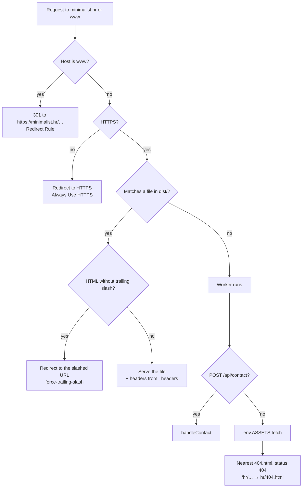

# Request lifecycle

What happens between a URL and a response in production.

## Step by step

1. **Edge rules.** Cloudflare's Redirect Rule sends `www.minimalist.hr` to the apex with a
   301, and Always Use HTTPS upgrades plain HTTP. Both run before the Worker.
2. **Static assets first.** If the path matches a file in `dist/` (after Cloudflare's HTML
   handling, so `/work/` serves `work/index.html`), it is served directly. The Worker script
   doesn't run, and the request doesn't count against Worker limits.
3. **Trailing slashes.** `html_handling: force-trailing-slash` redirects `/work` to `/work/`.
   Astro builds with `trailingSlash: 'always'`, so every internal link already has the slash.
4. **Headers.** `public/_headers` (copied into `dist/`) adds the security headers to every
   file and cache headers to `/_astro/*` and `/fonts/*`. On staging, CI has appended
   `X-Robots-Tag: noindex`.
5. **No match → Worker.** `src/worker/index.ts` checks for `/api/contact` and otherwise
   returns `env.ASSETS.fetch(request)`.
6. **Not found.** The asset server applies `not_found_handling: 404-page`: it serves the
   nearest `404.html` up the path with status 404. A missing `/hr/anything/` gets
   `dist/hr/404.html` (Croatian); everything else gets `dist/404.html`.
7. **In the browser.** The HTML carries its own CSP `<meta>` tag. Two inline scripts run before
   paint (JS flag, theme), then the bundled modules load. For browser requests Cloudflare also
   injects the Web Analytics beacon.

## The contact request

`POST /api/contact` matches no file, so it always reaches the Worker. The pipeline is described
in [Backend architecture](/Architecture/Backend-Architecture#the-contact-pipeline) and the whole
round trip in [Contact form](/How-It-Works/Contact-Form).

## Locally

| Command                                  | Behaves like production?                                                                  |
| :--------------------------------------- | :---------------------------------------------------------------------------------------- |
| `pnpm dev`                               | No. Astro's dev server: no `_headers`, no Worker, no `/api/contact`, its own 404 handling |
| `pnpm run preview`                       | Partly. Static `dist/` only                                                               |
| `pnpm exec wrangler dev` (after a build) | Yes. Same asset handling, headers, 404s and Worker as production, on the Workers runtime  |

The Playwright tests and Lighthouse run against `wrangler dev` for this reason.
